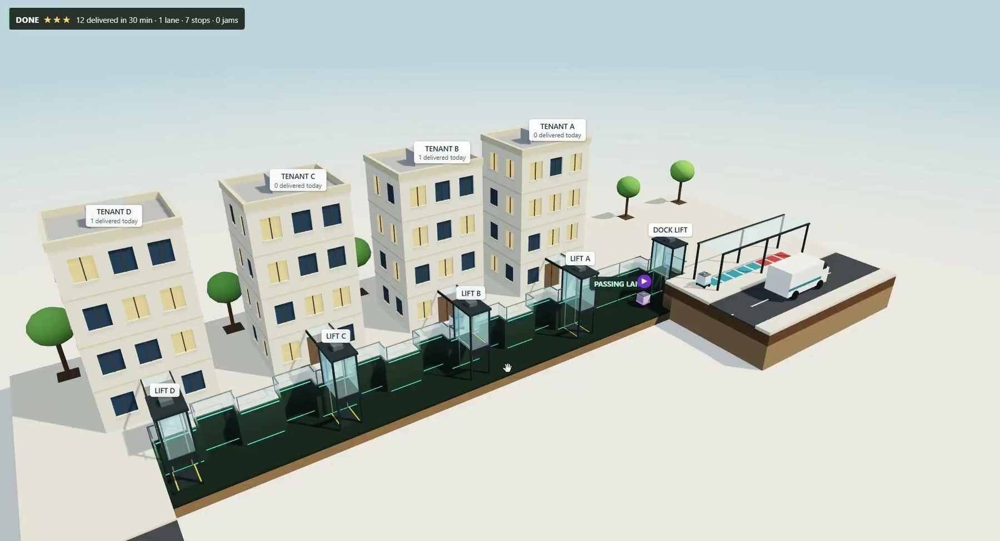

# Under the Block

**A micro-freight stratum beneath a city block.** One loading dock, one lane one storey under the plaza, and small robots carrying every delivery to four buildings.

ARC 327R · Architecture & Computation · UT Austin · Fall 2026 · Micah Reese
A2 Disposition Playground → A3 The Instrument

**Site:** [mhreese1-source.github.io/UnderTheBlock](https://mhreese1-source.github.io/UnderTheBlock/)



---

## The project

Deliveries stop clogging the curb. A van unloads at a dock, one lift lowers each cart below the plaza, and robots carry it along a single 1.7 m lane to the building it is for.

**What A2 found.** One narrow service trench became a network of compressed rows and passing pockets. Carts meeting head-on in a one-lane row deadlock, so passing bays appear where the conflicts happen. The toy turned failure into a spatial requirement.

**What A3 asks.** A truer toy, not a bigger one: one claim, one test, one correction. Ground the one number the verdict depends on, and let the toy predict before it is tested.

| Move | | Status |
|---|---|---|
| 1 · Contract | Claim, what the toy cannot know, the test; every rule and number in a ledger | drafted |
| 2 · Known result | The toy reproduces Little's law, L = λW, and the queue above capacity | reproduced |
| 3 · Bench test | Five unloads timed lap by lap at an H-E-B loading dock; arrival counts and the lift cycle still to measure | unloading measured |
| 4 · Correct, predict | Measured unloading swapped into the tracker: the dock crew, not the lift, is the narrowest step. Lock a prediction, test it | correction in |
| 5 · Evidence panel | Measured, sourced and assumed on screen | next |

## Two apps

Both run in the browser on a laptop or phone, and share one simulation: the same rows, passing bays, dock lift and jam rules.

| | What it does |
|---|---|
| [**Under the Block**](toy/index.html) | The live 3D model in section, the routing proposer, and the Little's law panel (Move 2) |
| [**Track**](track/index.html) | Live field dashboard: follow one package from van to tenant, pinned to its bay or row, with an honest ETA band ([README](track/README.md)) |

## Findings so far

**Known result.** Below capacity the toy matches Little's law within 4.3% across 9 runs. Above the dock lift's 30 carts/hr, its queue after 4 hours lands within 1 cart of (λ − μ) × 4 h in all 6 runs. With mail running the other way, the trench jammed in 6 of 16 runs, 2 of them below the lift's capacity.

## Bench test: H-E-B loading dock

Five unloads timed with a lap stopwatch, seven steps each. Steps 1–4 and 7 (open the doors, inspect, position the jack, pull the load onto the dock, scan) are dock work a crew still does at the stratum's dock. Steps 5–6 (carry to receiving, sort) are what the dock lift and robots take over.

| Trial | Delivery | Dock work (1–4 + 7) | Whole unload | Fits a cart |
|---|---|---|---|---|
| 1 | Standard grocery pallet | 37.6 s | 56.6 s | yes |
| 2 | Medium grocery items | 10:20 | 17:35 | yes |
| 3 | Large supplies and tools | 28:30 | 45:00 | no, forklift freight |
| 4 | Fresh produce | 11:00 | 18:45 | yes |
| 5 | Refrigerated dairy | 11:45 | 19:15 | yes |

- **Dock work per delivery: 8.4 ± 5.2 min** (trials 1, 2, 4, 5) `measured`. One crew handles about 7 deliveries an hour, against the lift's 30.
- Trial 1's laps add to 56.6 s, but its recorded overall time is 16:50.12. The laps are used; the stopwatch should be checked.
- Trials 2–5 are recorded to the nearest 5–15 s.
- One delivery is counted as one cart `assumed`.

**What it changed.** The A2 toy unloaded instantly, so the dock lift was the bottleneck. With the measured unloading the dock crew is. Controller and 10 bays on, 10 random 8-hour shifts per setting, highest rate where the queue stays bounded; low end leaves out trial 1:

| Dock crews | Carts / hr | Carts / 16-h day |
|---|---|---|
| Instant unloading (A2 rule) | 29 | 464 |
| 1 | 6–7 | 96–112 |
| 2 | 11–14 | 176–224 |
| **3** | **16–22** | **256–352** |
| 4 | 23–28 | 368–448 |
| 5 | 27–30 | 432–480 (the lift binds) |

Three crews is the fewest that keeps up with the toy's 16 carts an hour. With measured unloading the tracker's ETA bands held 62 of 80 packages (78%) inside their 80% window over three simulated days.

**What the stratum can carry without unloading** (the A2 rule; 10 random 8-hour shifts per setting; 16-hour day, assumed):

| Setting | Carts / 16-h day |
|---|---|
| 1 building, no controller | 256–464 |
| 2 buildings, no controller | 208 |
| 3 buildings, no controller | 112 |
| 4 buildings, no controller | 48 · jams in a median 2.7 h at 16 carts/hr |
| **4 buildings + traffic controller + 10 bays (as designed)** | **288–464** |
| + 12 bays + 1-minute dock lift | 624–928 |

- **Bottleneck:** with measured unloading, the dock crews (~7 deliveries an hour each) until 5 crews; then the dock lift, one cart every 2 minutes.
- **Floor plenums:** no. The robot is 1.05 m tall; office raised floors are 41–70 mm deep and data-centre floors 0.8–1.0 m ([Wikipedia, Raised floor](https://en.wikipedia.org/wiki/Raised_floor)).
- **Swarming:** one direction, yes, up to 18 robots in the lane and about 300 carts/hr. Two directions only with bays at every choke point plus the traffic controller.

**What the model cannot know.** Tenant lifts are drawn but not simulated. There is no maintenance, charging, turning radius or structure. The traffic controller is a planner rule, not physics. Arrival rate, lift cycle, robot speed, crews at the dock and the 16-hour day are assumed until measured. Unloading is measured at one grocery dock; a parcel dock may be faster.

## Repository

```
index.html        project homepage
images/           renders and screenshots used by the homepage
toy/index.html    Under the Block, the A3 model
track/            Track, the live dashboard, with its README and sim.js
```

Every page is a single self-contained HTML file: no build step, no install. Fonts load from Google Fonts and fall back to system fonts offline.
